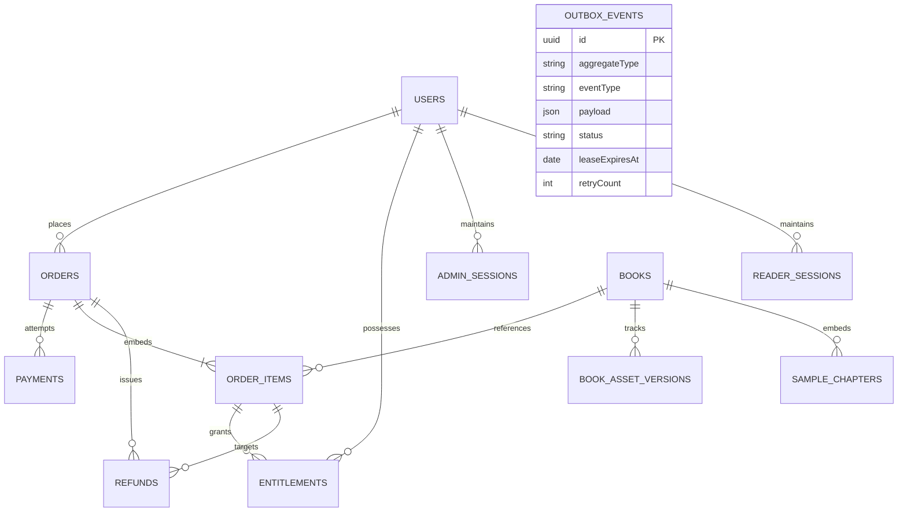
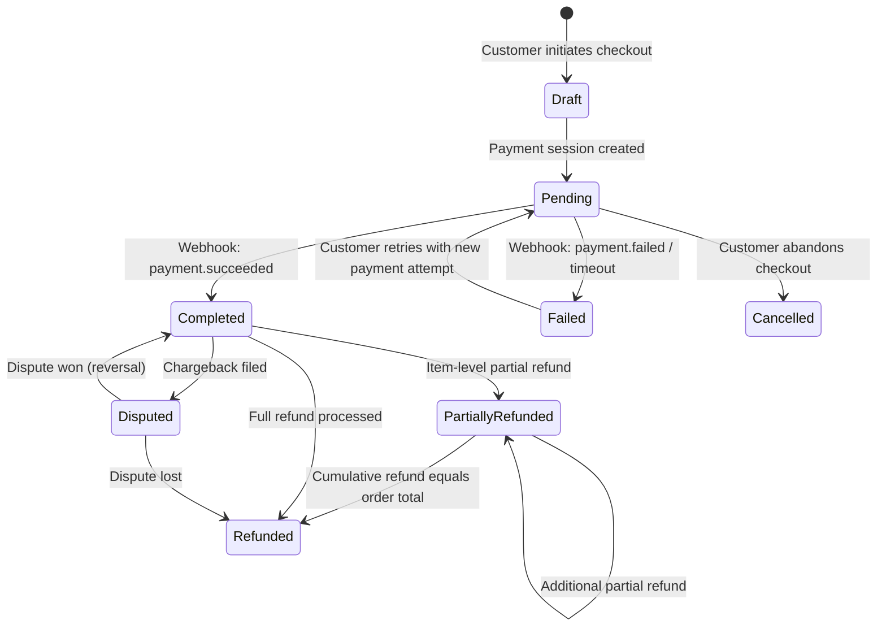
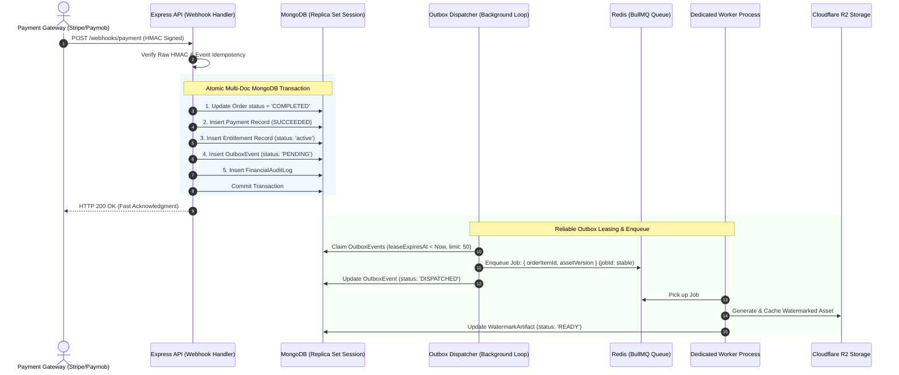
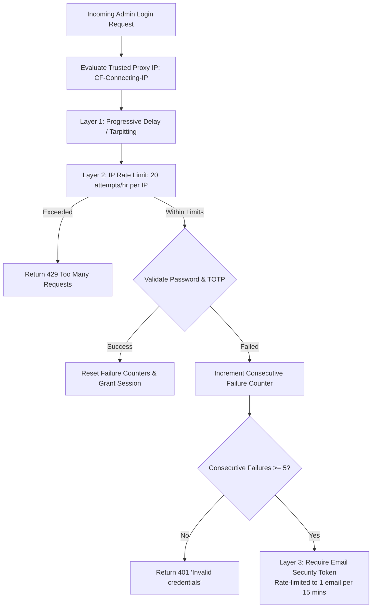
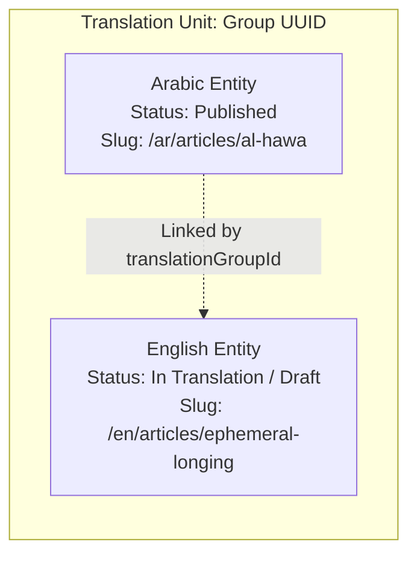

# PHASE 0 — MASTER ARCHITECTURAL SPECIFICATION
## Hadeer Mamdouh — Contemporary Literary Platform & Sovereign Atelier (المنصة الأدبية)

> **Document Status**: Consolidated Specification — Submitted for Product Owner Final Review  
> **Phase Status**: Phase 0 In Progress (OPEN / AWAITING APPROVAL)  
> **Implementation Authorization**: Phase 1 STRICTLY NOT AUTHORIZED  
> **Platform Classification**: Contemporary Arabic Literary Platform & Sovereign Digital Bookstore  
> **Platform Owner**: Hadeer Mamdouh  
> **Architectural Authority**: Principal Software Architect, Systems Engineer, Security Architect & Database Architect  
> **Execution Constraint**: Planning & Architecture Only (Zero code, packages, or database modifications initiated)  

---

## Table of Contents
1. [Platform Vision, Spatial Universe & Product Scope](#1-platform-vision-spatial-universe--product-scope)
2. [Unified-Origin System Topology & Monorepo Architecture](#2-unified-origin-system-topology--monorepo-architecture)
3. [Defensive Database Architecture & Domain Service Integrity](#3-defensive-database-architecture--domain-service-integrity)
4. [Data Domain Contracts & Entity Models](#4-data-domain-contracts--entity-models)
5. [Payment Domain, Financial State Model & Two-Layer Webhook Idempotency](#5-payment-domain-financial-state-model--two-layer-webhook-idempotency)
6. [Transactional Outbox Pattern & Reliable Fulfillment Engine](#6-transactional-outbox-pattern--reliable-fulfillment-engine)
7. [Two-Track Authentication Architecture, CSRF & Layered Rate Limiting](#7-two-track-authentication-architecture-csrf--layered-rate-limiting)
8. [Admin Security, MFA Recovery & Risk-Based Anomaly Signals](#8-admin-security-mfa-recovery--risk-based-anomaly-signals)
9. [Multilingual & Content Engine (Arabic-First)](#9-multilingual--content-engine-arabic-first)
10. [Author Editorial CMS Studio](#10-author-editorial-cms-studio)
11. [Reader Authorization: Public Preview vs. Authenticated Full Reading](#11-reader-authorization-public-preview-vs-authenticated-full-reading)
12. [Tiered Asset Watermarking, Delivery & Failure Recovery](#12-tiered-asset-watermarking-delivery--failure-recovery)
13. [Audience Engine: Newsletter & Email Infrastructure](#13-audience-engine-newsletter--email-infrastructure)
14. [Security Architecture & Threat Mitigation Contracts](#14-security-architecture--threat-mitigation-contracts)
15. [Risk-Weighted Testing Strategy & Mandatory Test Cases](#15-risk-weighted-testing-strategy--mandatory-test-cases)
16. [DevOps, Realistic Downtime Minimization & Tiered Disaster Recovery](#16-devops-realistic-downtime-minimization--tiered-disaster-recovery)
17. [Observability & Decoupled Health Checks](#17-observability--decoupled-health-checks)
18. [Privacy by Design, Data Governance & Compliance](#18-privacy-by-design-data-governance--compliance)
19. [Definitive 15-Phase Engineering Roadmap & Release Milestones](#19-definitive-15-phase-engineering-roadmap--release-milestones)
20. [Architecture Decision Records (ADRs)](#20-architecture-decision-records-adrs)
21. [Consolidated Production Risk Register](#21-consolidated-production-risk-register)
22. [Phase 1 Readiness Verification Gate](#22-phase-1-readiness-verification-gate)

---

## 1. Platform Vision, Spatial Universe & Product Scope

### 1.1 The Unified Universe Principle
The Hadeer Mamdouh Literary Platform is a sovereign digital universe representing a contemporary Arabic author, essayist, and novelist. The platform eliminates the disjointed experience of running separate sub-sites (a personal blog, an author portfolio, a commercial bookstore, and a third-party newsletter) by uniting three spatial domains into a single architectural ecosystem:

```
┌────────────────────────────────────────────────────────────────────────┐
│                        HADEER MAMDOUH UNIVERSE                         │
│               (Unified Identity, Design System & Domain)               │
└───────────────────────────────────┬────────────────────────────────────┘
                                    │
        ┌───────────────────────────┼───────────────────────────┐
        │                           │                           │
        ▼                           ▼                           ▼
┌──────────────────┐       ┌──────────────────┐       ┌──────────────────┐
│  THE SANCTUARY   │       │   THE ARCHIVE    │       │   THE ATELIER    │
│    (Reflections) │       │    (Articles)    │       │   (Bookstore)    │
│  Poetic, brief,  │       │  Long-form deep  │       │  Digital novels, │
│  contemplative,  │       │  essays, print   │       │  sample reader,  │
│  high-resonance  │       │  typography,     │       │  customer library│
│  reflections     │       │  intellectual    │       │  & watermarking  │
└──────────────────┘       └──────────────────┘       └──────────────────┘
```

### 1.2 Persona Taxonomy & User Journeys

| Persona | Context & Intent | Primary Platform Touchpoint | Friction to Eliminate | Key Conversion Metric |
| :--- | :--- | :--- | :--- | :--- |
| **The Epigrammatic Seeker** | Arrives via mobile from social media; reads short thoughts during daily transit. | The Sanctuary (`/ar/reflections/*`) | Intrusive popups, layout shift, slow fonts. | Quote card share, 1-click newsletter join. |
| **The Dedicated Scholar** | Reads 3,000-word critical essays; demands print-quality typographic comfort. | The Archive (`/ar/articles/*`) | Eye strain, poor line-height, distracting ads. | Footnote reading, essay bookmarking. |
| **The Literary Patron** | Discovers novels; desires instant sample reading and frictionless purchase. | The Atelier (`/ar/books/*`) | Forced pre-purchase registration walls. | Chapter 1 preview $\rightarrow$ Guest checkout. |
| **The Returning Reader** | Accesses purchased books; reads in web viewer or exports to e-reader. | Customer Library (`/ar/library/*`) | Lost download links, complex DRM apps. | Persistent session, seamless EPUB/PDF download. |
| **The Author / Admin** | Composes, edits, schedules, monitors readership and revenue. | Editorial Studio (`/admin/*`) | Clunky rich-text editing, manual code edits. | Distraction-free composition, live preview. |

### 1.3 System Scope & Release Boundaries (Reconciled with Roadmap)
To eliminate contradictions between release promises and engineering deliverables, product capabilities are strictly mapped to their implementation phases:

- **Release 1.0 (Content & Showcase MVP — Phases 1 through 9)**:
  - Full author branding and literary design system.
  - Reflections (خواطر) micro-publishing engine.
  - Articles (مقالات) long-form intellectual archive with archival typography.
  - Author Editorial CMS Studio (`/admin`) with Tiptap block editor and draft workflows.
  - Multilingual routing (`/ar/*`, `/en/*`) with decoupled translations.
  - Book Catalog Showcase and Public Chapter 1 Interactive Previewer (implemented in Phase 8).
  - Audience Engine: Double opt-in newsletter and private "Letter to the Author" reader form (implemented in Phase 9).
  - *Completely accessible without reader accounts or commercial payment infrastructure.*
- **Release 1.1 (Commerce & Atelier Activation — Phases 10 through 13)**:
  - Search and Content Discovery engine (Phase 10).
  - Reader Authentication, Magic Links, and Customer Account profiles (Phase 11).
  - Multi-currency live payment gateway orchestration, Two-Layer Webhook Idempotency, and Transactional Outbox engine (Phase 12).
  - Customer Library, In-Browser Authenticated Web Reader, Tiered Dynamic Watermarking, and Cloudflare R2 delivery (Phase 13).
- **Release 1.2 (Hardening & Intelligence — Phases 14 and 15)**:
  - First-party cookieless analytics and author dashboard (Phase 14).
  - Production security penetration testing, WCAG 2.2 AA accessibility verification, and automated disaster recovery drills (Phase 15).
- **Explicit Post-MVP Exclusions**: Physical inventory shipping, multi-vendor marketplace functionality, public user comment threads, and third-party advertising tracking.

---

## 2. Unified-Origin System Topology & Monorepo Architecture

```mermaid
graph TD
    Client[Reader / Author Browser] -->|HTTPS| Cloudflare[Cloudflare Edge CDN & WAF]
    Cloudflare --> Gateway[Nginx Reverse Proxy Gateway<br/>Single Origin: hadeermamdouh.com]
    
    Gateway -->|/api/* & /webhooks/*| ExpressAPI[Express 5 Modular Monolith API<br/>apps/api]
    Gateway -->|/* (All HTML Routes & SSR)| NextWeb[Next.js 15 Web Service<br/>apps/web]
    
    ExpressAPI --> MongoCluster[(MongoDB Atlas Replica Set<br/>ACID Multi-Doc Transactions)]
    ExpressAPI --> R2Storage[(Cloudflare R2 Bucket<br/>Encrypted Master & Stamped Assets)]
    
    subgraph Background Processing Tier
        ExpressAPI -.->|Stage 1: In-Process Queue| MemoryQueue[p-queue: Non-critical Jobs]
        ExpressAPI -.->|Stage 2: Outbox Dispatcher| RedisQueue[(Redis / BullMQ Durable Queue)]
        RedisQueue --> WorkerProc[Dedicated Worker Process<br/>apps/worker]
        WorkerProc --> MongoCluster
        WorkerProc --> R2Storage
    end
```

### 2.1 Unified-Origin Reverse-Proxy Strategy & Trusted Proxy Chain
Both the Next.js presentation server and Express REST API run behind a unified origin:
- `https://hadeermamdouh.com/*` $\rightarrow$ Next.js 15 frontend application.
- `https://hadeermamdouh.com/api/*` $\rightarrow$ Express 5 backend API.
- `https://hadeermamdouh.com/webhooks/*` $\rightarrow$ Raw-body payment webhook handlers.

#### Trusted Proxy Chain Configuration & Security Assumptions:
To prevent IP spoofing while correctly evaluating client IPs for rate-limiting:
1. **Cloudflare (Edge)**: Receives client connections, validates edge SSL/WAF, and forwards client IP in the `CF-Connecting-IP` header.
2. **Nginx (Gateway)**: Configured with official Cloudflare IP ranges using `set_real_ip_from` and `real_ip_header CF-Connecting-IP`. Nginx sanitizes and overwrites incoming `X-Forwarded-For` with `$remote_addr`. Nginx is the **only permitted public ingress**; firewall rules (UFW/iptables) block direct external access to internal container ports.
3. **Express API**: Configured with explicit trusted subnets: `app.set('trust proxy', 'loopback, 172.16.0.0/12')`. Blind `trust proxy: 1` or boolean `true` is strictly prohibited.
- **Operational Dependency**: The integrity of client IP resolution relies on Cloudflare edge rules remaining active and Nginx headers not being bypassed.

### 2.2 Monorepo Directory Layout
```
Hadeer-Literary-Platform/
├── apps/
│   ├── web/                          # Next.js 15 Frontend Application
│   │   ├── src/
│   │   │   ├── app/                  # App Router (localized [locale] routes)
│   │   │   ├── components/           # UI Components (editorial, reader, design system)
│   │   │   ├── lib/                  # API client, font configurations, i18n
│   │   │   └── styles/               # CSS tokens, print rules, logical properties
│   │   ├── public/                   # Static assets, manifests, robots.txt
│   │   └── package.json
│   │
│   ├── api/                          # Express 5 REST API Application
│   │   ├── src/
│   │   │   ├── config/               # Environment, database, R2 client
│   │   │   ├── modules/              # Domain-Driven Modules
│   │   │   │   ├── auth/             # Admin & Reader Auth controllers & services
│   │   │   │   ├── reflections/      # Sanctuary module
│   │   │   │   ├── articles/         # Archive module
│   │   │   │   ├── books/            # Book catalog & preview module
│   │   │   │   ├── orders/           # Checkout & order management
│   │   │   │   ├── payments/         # Payment attempts & webhook processing
│   │   │   │   ├── outbox/           # Transactional Outbox dispatcher
│   │   │   │   ├── entitlements/     # Customer library & download security
│   │   │   │   └── audience/         # Newsletter & Letters to Author
│   │   │   ├── middlewares/          # Auth guards, rate limiting, error handlers
│   │   │   └── app.ts                # Express application bootstrapping
│   │   └── package.json
│   │
│   └── worker/                       # Dedicated Background Worker (Phase 12+)
│       ├── src/
│       │   ├── processors/           # PDF/EPUB watermarking, bulk email dispatch
│       │   └── index.ts              # BullMQ worker runner
│       └── package.json
│
├── packages/
│   ├── types/                        # Shared TypeScript DTOs & Domain Contracts
│   ├── validation/                   # Shared Zod Schemas
│   └── config/                       # Shared ESLint, Prettier, TSConfig
│
├── docs/                             # Architectural Specifications & ADRs
│   └── architecture/
│       └── PHASE_0_BLUEPRINT.md
│
├── docker-compose.yml                # Production orchestration definition
├── package.json                      # Monorepo root workspace definition
└── tsconfig.base.json                # Strict TypeScript base configuration
```

---

## 3. Defensive Database Architecture & Domain Service Integrity

The platform utilizes **MongoDB and Mongoose**, fortified with defensive patterns to guarantee transactional reliability for digital commerce and content archival.

### 3.1 Deployment Requirement: Mandatory Replica Set
Multi-document ACID transactions in MongoDB strictly require a replica set. Standalone MongoDB instances do not support transactions.
- **Production**: MongoDB Atlas M10+ replica set (automated high availability, continuous oplog backup).
- **Development/Staging**: 3-node local replica set configured via Docker Compose (`rs0`).

### 3.2 Database-Level JSON Schema Validation
In addition to Mongoose validation, collections enforce database-level `$jsonSchema` validators directly inside the MongoDB engine:
- Strict BSON type checks (`string`, `int`, `date`, `objectId`, `bool`).
- String pattern regex for emails, ISBNs, and localized slugs.
- Numerical constraints: `priceCents >= 0`, `readingTimeMinutes >= 1`.
- Enum constraints on statuses:
  - `Order.status`: `['DRAFT', 'PENDING', 'COMPLETED', 'FAILED', 'CANCELLED', 'REFUNDED', 'PARTIALLY_REFUNDED', 'DISPUTED']`.
  - `Payment.status`: `['INITIATED', 'REQUIRES_ACTION', 'SUCCEEDED', 'FAILED', 'CANCELLED']`.
  - `Book.status`: `['draft', 'published', 'archived']`.

### 3.3 Domain Service Deletion Integrity (Overcoming Mongoose Hook Limits)
> [!IMPORTANT]
> **Architectural Guardrail**: Mongoose middleware hooks (`pre('deleteOne')`, `pre('remove')`) are completely bypassed by `findByIdAndDelete`, `deleteMany`, raw MongoDB driver queries, or bulk operations. Therefore, **Mongoose hooks alone DO NOT guarantee referential integrity**.

To guarantee that books with historical purchases are never orphaned:
1. **Application-Level Domain Services**: Deletions must pass strictly through dedicated domain services (`ContentDeletionService`, `BookArchivalService`). Direct model deletion queries outside these services are prohibited by architectural convention and code review.
2. **Prohibition of Hard Deletion on Core Entities**: Hard deletion of Books, Orders, Payments, and Entitlements is strictly prohibited. Collections enforce a `deletedAt: Date | null` soft-delete field.
3. **The Book Archival Contract**: When an author "deletes" a book:
   - The domain service checks if active `Entitlement` records reference the `bookId`.
   - If entitlements exist, the book's status transitions to `ARCHIVED` and `isAvailable` is set to `false`. It is removed from the public catalog, but its metadata, chapters, and asset keys are permanently preserved so existing patrons retain continuous access to their purchased library.

---

## 4. Data Domain Contracts & Entity Models



### 4.1 Core Domain Entities & Structural Rules
1. **`User` Entity**: `email` (unique, indexed), `role` (`reader` | `admin`), `passwordHash` (Argon2id, admin only), `totpSecret` (encrypted, admin only), `emergencyCodes` (`[{ codeHash, usedAt }]`), `localePreference` (`ar` | `en`), `createdAt`, `updatedAt`.
2. **`Order` Entity**: `orderNumber` (unique string), `userId` (`ObjectId` reference), `customerEmail`, `items` (`[OrderItem]` subdocuments), `totalAmountCents`, `totalRefundedCents` (default 0), `currency`, `status` (`DRAFT`, `PENDING`, `COMPLETED`, `FAILED`, `CANCELLED`, `REFUNDED`, `PARTIALLY_REFUNDED`, `DISPUTED`), `idempotencyKey` (unique partial index), `createdAt`, `updatedAt`.
3. **`OrderItem` Subdocument Contract**:
   - `orderItemId` (`UUID` string, immutable stable identity).
   - `bookId` (`ObjectId` reference to Book).
   - `assetVersionAtPurchase` (`int`).
   - `titleAtPurchase` (`string`).
   - `priceCentsAtPurchase` (`int`).
   - `discountCents` (`int`, default 0).
   - `taxCents` (`int`, default 0).
   - `netPaidCents` (`int`, calculated as $\text{price} - \text{discount} + \text{tax}$).
   - `refundedAmountCents` (`int`, default 0, tracks cumulative refunds for this item).
   - `currency` (`string`).
4. **`Payment` Entity**:
   - `orderId` (`ObjectId`).
   - `attemptNumber` (`int`, 1-based sequential counter).
   - `paymentProvider` (`stripe` | `paymob` | `tap`).
   - `providerTransactionId` (`string`, unique partial index).
   - `amountCents` (`int`), `currency` (`string`).
   - `status` (`INITIATED`, `REQUIRES_ACTION`, `SUCCEEDED`, `FAILED`, `CANCELLED`).
   - `idempotencyKey` (`string`, unique index).
   - `failureReason` (`string | null`).
   - Compound unique index on `{ orderId: 1, attemptNumber: 1 }`.
   - Partial unique index on `{ providerTransactionId: 1 }` where `{ providerTransactionId: { $type: "string" } }`.
5. **`Refund` Entity**:
   - `orderId` (`ObjectId`), `paymentId` (`ObjectId`).
   - `providerRefundId` (`string`, unique partial index).
   - `amountCents` (`int`), `currency` (`string`).
   - `reason` (`string`).
   - `refundedItems` (`[{ orderItemId: UUID, amountCents: int }]`).
   - `status` (`PENDING`, `SUCCEEDED`, `FAILED`).
6. **`Entitlement` Entity**:
   - `_id` (`ObjectId`).
   - `userId` (`ObjectId`), `bookId` (`ObjectId`), `orderId` (`ObjectId`), `orderItemId` (`UUID`).
   - `grantedAssetVersion` (`int`).
   - `status` (`active` | `suspended` | `revoked`).
   - `reason` (`REFUND` | `CHARGEBACK_DISPUTE` | `FRAUD` | `ADMIN_REVOCATION` | `null`).
   - `grantedAt` (`Date`), `revokedAt` (`Date | null`).
   - Unique index on `{ orderItemId: 1 }` (guarantees one entitlement per purchased order item).
   - Partial unique index on `{ userId: 1, bookId: 1 }` where `{ status: "active" }` (allows repurchases after refund).
7. **`OutboxEvent` Entity (Reliable Queue Dispatch Only)**:
   - `aggregateType` (`ORDER`, `PAYMENT`, `NEWSLETTER`).
   - `aggregateId` (`ObjectId`).
   - `eventType` (`ORDER_FULFILLMENT`, `REFUND_REVOCATION`).
   - `payload` (`BSON Document`).
   - `status` (`PENDING`, `PROCESSING`, `DISPATCHED`, `DEAD_LETTER`).
   - `claimLease`: `{ lockedAt: Date | null, lockedBy: string | null, leaseExpiresAt: Date | null }`.
   - `retryCount` (`int`, max 5), `lastError` (`string | null`).
   - `dispatchedAt` (`Date | null`).
8. **`WebhookEvent` Entity**:
   - `provider` (`string`), `providerEventId` (`string`).
   - `eventType` (`string`).
   - `status` (`RECEIVED`, `PROCESSING`, `PROCESSED`, `FAILED`, `TERMINAL_ERROR`).
   - `retryCount` (`int`), `lastError` (`string | null`).
   - `receivedAt` (`Date`), `processedAt` (`Date | null`).
   - Compound unique index on `{ provider: 1, providerEventId: 1 }`.
9. **`FinancialAuditLog` (Append-Only Chained Ledger)**:
   - `orderId`, `paymentId`, `refundId`.
   - `eventType` (`PAYMENT_SUCCEEDED`, `REFUND_ISSUED`, `DISPUTE_FILED`, `DISPUTE_WON`).
   - `amountCents`, `currency`, `actor` (`SYSTEM`, `STRIPE_WEBHOOK`, `ADMIN`), `actorId`.
   - `previousLogChecksum` (`string`), `checksum` (`SHA-256` of current record + previous checksum).
   - Append-only: updates and deletes are rejected at domain service layer.
10. **`Book` Entity Contract**:
    - `slug` (`string`, unique per locale).
    - `locale` (`ar` | `en`), `translationGroupId` (`UUID`).
    - `title` (`string`), `subtitle` (`string | null`), `synopsis` (`string`).
    - `coverImageUrl` (`string`), `priceCents` (`int`), `currency` (`USD` | `EGP`).
    - `isAvailable` (`bool`), `isbn` (`string | null`, partial unique index).
    - `sampleChapters` (`[{ chapterIndex: int, title: string, contentAst: JSONB }]`).
    - `currentAssetVersion` (`int`, default 1).
    - `status` (`draft` | `published` | `archived`), `publishedAt` (`Date | null`).
11. **`Article` & `ArticleRevision` Contract (Draft vs. Published)**:
    - `Article` document stores public published fields (`title`, `slug`, `bodyAst`, `publishedAt`, `currentRevisionNumber`).
    - `ArticleRevision` stores historical and draft states: `articleId`, `revisionNumber`, `title`, `bodyAst`, `excerpt`, `authorId`, `status` (`DRAFT`, `PUBLISHED`, `ARCHIVED`). The public site queries `Article` directly; editing operates on `ArticleRevision` until published.
12. **`AdminSession` Contract**:
    - `adminId` (`ObjectId`), `sessionTokenHash` (`string`, unique index).
    - `csrfSecret` (`string`), `userAgentFamily` (`string`), `asn` (`string | null`), `country` (`string | null`).
    - `expiresAt` (`Date`, rolling 4 hours), `lastActiveAt` (`Date`), `revokedAt` (`Date | null`).
13. **`ReaderSession` Contract**:
    - `readerId` (`ObjectId`), `refreshTokenHash` (`string`, unique index).
    - `familyId` (`UUID`, for rotation and reuse detection).
    - `expiresAt` (`Date`, sliding 30 days), `lastActiveAt` (`Date`), `revokedAt` (`Date | null`).

---

## 5. Payment Domain, Financial State Model & Two-Layer Webhook Idempotency

### 5.1 Reconciled Financial State Machine



### 5.2 Payment Attempts, Retries & Late Success Handling
- **Attempt Selection**: When an order transitions to `PENDING`, `Payment` Attempt #1 is created with `attemptNumber: 1` and `status: 'INITIATED'`.
- **Payment Retries**: If Attempt #1 fails (e.g. card declined), `Payment[1].status` transitions to `FAILED`. When the customer retries, Attempt #2 is created with `attemptNumber: 2`. At any given moment, only **one** payment attempt per order may be in `INITIATED` or `REQUIRES_ACTION`.
- **Late Success Handling**: If Attempt #1 succeeds *after* Attempt #2 has already succeeded:
  1. The webhook handler processes Attempt #1's success event.
  2. It checks `Order.status`. Because the order is already `COMPLETED`, it recognizes a **Duplicate Successful Charge**.
  3. It transitions `Payment[1].status = 'SUCCEEDED'`, but strictly **does not create duplicate entitlements**.
  4. It writes an `OutboxEvent` of type `PAYMENT_DUPLICATE_AUTO_REFUND` (or flags `Order.reconciliationRequired = true` with admin alert) to automatically trigger an external refund of Attempt #1 through the provider API.

### 5.3 Enforceable Cumulative Refund Limits
To eliminate race conditions during concurrent refund requests, refunds are guarded by MongoDB conditional atomic updates:
```typescript
const updatedOrder = await Order.findOneAndUpdate(
  {
    _id: orderId,
    status: { $in: ['COMPLETED', 'PARTIALLY_REFUNDED'] },
    totalRefundedCents: { $lte: order.totalAmountCents - newRefundAmountCents },
    items: {
      $elemMatch: {
        orderItemId: item.orderItemId,
        refundedAmountCents: { $lte: item.netPaidCents - itemRefundAmountCents }
      }
    }
  },
  {
    $inc: {
      totalRefundedCents: newRefundAmountCents,
      "items.$.refundedAmountCents": itemRefundAmountCents
    },
    $set: {
      status: (order.totalRefundedCents + newRefundAmountCents === order.totalAmountCents)
        ? 'REFUNDED'
        : 'PARTIALLY_REFUNDED'
    }
  },
  { session, new: true }
);
if (!updatedOrder) {
  throw new ConflictException('Refund exceeds refundable balance or concurrent refund in progress');
}
```

### 5.4 Two-Layer Webhook Idempotency
- **Layer 1 (Provider Event-Level)**: HMAC verification on raw binary request buffers + deduplication check against the `WebhookEvents` collection (`{ provider, providerEventId }` unique index).
- **Layer 2 (Business Operation-Level)**: Unique partial index on `providerTransactionId` in `Payments` + conditional atomic updates on `Orders`. Stale out-of-order failure webhooks are safely ignored.

---

## 6. Transactional Outbox Pattern & Reliable Fulfillment Engine

> [!CAUTION]
> **Distributed Systems Rule**: A MongoDB transaction **cannot** atomically coordinate with Redis/BullMQ. Claiming that a database commit and a Redis message queue enqueue succeed or fail together is fundamentally incorrect.

To guarantee that paying customers never lose their purchased digital books if Redis or the background worker is down, the platform implements the **Transactional Outbox Pattern**:



### 6.1 Exact Outbox Leasing & Crash Recovery Contracts
- **Claim Lease**: The dispatcher queries events with `status: 'PENDING'` or `{ status: 'PROCESSING', 'claimLease.leaseExpiresAt': { $lt: new Date() } }`, setting `status = 'PROCESSING'`, `claimLease.lockedBy = instanceId`, and `claimLease.leaseExpiresAt = new Date(Date.now() + 60000)`.
- **Dispatcher Crash Recovery**: If a dispatcher crashes after enqueuing into Redis but before updating MongoDB:
  1. The 60-second lease expires.
  2. Another dispatcher reclaims the event and enqueues it into BullMQ again.
  3. **BullMQ Job Deduplication**: The job ID passed to BullMQ is strictly deterministic: `jobId = "outbox:" + outboxEvent._id`. BullMQ natively de-duplicates jobs by ID, safely ignoring the duplicate enqueue.
- **Dead Letter Queue (DLQ)**: Events exceeding 5 retry attempts transition to `DEAD_LETTER`, triggering an automated administrative alert.

---

## 7. Two-Track Authentication Architecture, CSRF & Layered Rate Limiting

```
┌────────────────────────────────────────────────────────────────────────┐
│                   TWO-TRACK AUTHENTICATION MODEL                       │
├───────────────────────────────────┬────────────────────────────────────┤
│ TRACK 1: ADMIN AUTHENTICATION     │ TRACK 2: READER AUTHENTICATION     │
│ (Phase 4 — Pre-CMS Requirement)   │ (Phase 11 — Pre-Store Requirement) │
├───────────────────────────────────┼────────────────────────────────────┤
│ • Protects Author CMS & Studio    │ • Protects Customer Library        │
│ • Single Author / Highest Security│ • Broad Audience / Low Friction    │
│ • Argon2id + Mandatory TOTP MFA   │ • Passwordless Magic Links + OAuth │
│ • Rolling 4-hour Admin Session    │ • 30-day Persistent Refresh Cookie │
│ • Risk-Based Anomaly Signals      │ • Self-Service Data & Erasure      │
│ • Single-Use Emergency MFA Codes  │ • Guest-to-Account Auto-Linking    │
└───────────────────────────────────┴────────────────────────────────────┘
```

### 7.1 Layered Admin Login Protection & Email Abuse Prevention


- **Protection Against Email Flooding**: When account-level defense activates after 5 failures, the system dispatches an unlock code to the author's email. To prevent attackers from weaponizing this into an email flood against the author, **unlock email dispatch is strictly rate-limited to 1 email every 15 minutes**. Subsequent failed attempts continue to fail silently with generic `401 Unauthorized` responses.

### 7.2 CSRF Protection & Next.js CSP Nonce Strategy
- **Signed Double Submit Cookie Pattern**:
  - The server issues an `HttpOnly`, `Secure`, `SameSite=Lax` cookie `__Host-csrf-secret` containing a cryptographic secret.
  - The server exposes a masked, signed token via the `X-CSRF-Token` response header (or readable cookie `csrf-token`).
  - On state-changing mutations (`POST`, `PUT`, `PATCH`, `DELETE`), Express validates that `X-CSRF-Token` matches the secret.
  - Safe methods (`GET`, `HEAD`, `OPTIONS`) are exempt.
- **Content Security Policy (CSP)**: Next.js middleware generates a 16-byte cryptographically secure random base64 **nonce** per request (`crypto.randomBytes(16).toString('base64')`), injected into the `Content-Security-Policy` header:
  `script-src 'self' 'nonce-${nonce}' 'strict-dynamic'; style-src 'self' 'nonce-${nonce}'; font-src 'self' data:; img-src 'self' https://imagedelivery.net data:; connect-src 'self'; frame-ancestors 'none'; object-src 'none'; base-uri 'self';`
  - Deployed in Report-Only mode during initial staging, transitioning to enforced policy after verification.

---

## 8. Admin Security, MFA Recovery & Risk-Based Anomaly Signals

### 8.1 Reassessing Client Fingerprinting: Risk Signal, Not Session Blocker
The admin session tracks client characteristics (User-Agent Family, Client TLS properties, ASN, and Country).
- **Non-Invasive Nature**: It does not employ privacy-invasive canvas, audio, or hardware probing scripts.
- **Security Role**: It is **not** a hard session-binding constraint. Legitimate changes in IP address (mobile network transitions, home broadband reconnects, VPN usage) **never** terminate the author's session.
- **Adaptive Challenge Policy**: If a request arrives with a valid session token but originates from an anomalous country or unfamiliar ASN:
  1. The author's current editing session is **not** abruptly terminated.
  2. A high-priority security notification is dispatched to the author's verified email.
  3. A quick TOTP step-up re-authentication is required **only** when attempting sensitive operations: publishing content, modifying bank/payout configurations, or deleting documents.

### 8.2 Admin MFA Recovery Procedures
1. **Layer 1: Cryptographic Emergency Backup Codes (Self-Service)**:
   - 8 single-use, cryptographically random backup codes (`XXXXX-XXXXX`) generated upon MFA enrollment.
   - Hashed using Argon2id prior to database storage.
   - Redeeming a code marks it `usedAt: new Date()`, grants temporary access, dispatches a security alert email, and requires immediate MFA re-enrollment.
2. **Layer 2: Host-Level Break-Glass CLI Utility (Offline Failsafe)**:
   - Command: `npm run admin:mfa-reset`.
   - Accessible strictly via direct SSH access to the production server.
   - Requires Linux `sudo/root` execution privileges and entry of `APP_MASTER_KEY`.
   - Completely decoupled from public HTTP endpoints (zero remote attack surface).

---

## 9. Multilingual & Content Engine (Arabic-First)

### 9.1 Decoupled Translation Architecture
Arabic is the source language of thought; English translations are bespoke literary adaptations created asynchronously. Content entities are **loosely linked by a shared `translationGroupId`**:



#### Handling Untranslated Content:
- Requesting an untranslated English path returns an explicit `404 Not Found` (never a blank page or an English shell with Arabic text).
- The UI language switcher displays: *"الترجمة الإنجليزية قيد الإعداد — English translation forthcoming"* and links safely to the English catalog index.
- **Strict Hreflang Suppression**: The server emits an alternate `hreflang` tag **only if the translated document exists and is published**. Untranslated pages emit zero alternate tags, preventing Google Search Console crawl errors and ranking penalties.

### 9.2 Arabic Typography & Dual-Slug Architecture
- **Font Stack**: Self-hosted variable fonts (*IBM Plex Sans Arabic* for body prose, *Amiri* for titles/quotes) using `next/font` with glyph subsetting (stripping unused scripts to reduce payload to ~85KB) and zero layout shift (`size-adjust` fallbacks).
- **Typographic Rules**: `letter-spacing: 0 !important;` (positive tracking breaks cursive ligatures in Arabic script); `line-height: 1.85` on body prose; headings use `text-wrap: balance;`.
- **Dual-Slug Architecture**:
  - *Canonical Web URL*: Clean, readable Arabic slugs: `/ar/articles/عزلة-الكاتب-في-العصر-الرقمي`.
  - *Social Sharing Link*: To prevent messaging apps (WhatsApp, X, Telegram) from encoding Arabic characters into unsightly strings (`%D8%B9%D8%B2...`), sharing buttons generate a clean base62 short-link (`/r/k8x2`) that issues an immediate 301 redirect to the canonical Arabic page.

---

## 10. Author Editorial CMS Studio

Located at `/admin`, the in-platform studio provides an author-first writing experience:
- **Tiptap / ProseMirror Block Editor**: Tailored for Arabic prose, poetry, and intellectual essays:
  - Classical two-hemistich poetry formatting (شعر عمودي وحر).
  - Footnotes with auto-numbering and bidirectional jump links.
  - Blockquotes with author and source attribution fields.
  - Bespoke typographic ornament dividers (فواصل مطبعية راقية).
- **Workflow Engine**: `draft` $\rightarrow$ `scheduled` $\rightarrow$ `published` $\rightarrow$ `archived`.
- **Side-by-Side Translation Workspace**: Displays original Arabic text on the right pane while composing or reviewing the English adaptation on the left pane.
- **Edge Cache Purging**: Publishing triggers a signed webhook to Next.js (`POST /api/revalidate`), purging the CDN/ISR cache asynchronously.

---

## 11. Reader Authorization: Public Preview vs. Authenticated Full Reading

```
┌────────────────────────────────────────────────────────────────────────┐
│                   READER ACCESS & AUTHORIZATION TIERS                  │
├────────────────────────┬─────────────────────┬─────────────────────────┤
│ Access Tier            │ Authentication      │ Delivery & Source       │
├────────────────────────┼─────────────────────┼─────────────────────────┤
│ Tier A: Public Sample  │ Anonymous / Public  │ Public Book Document:   │
│ Chapter Previewer      │ (Zero Auth Needed)  │ sampleChapters (JSON)   │
├────────────────────────┼─────────────────────┼─────────────────────────┤
│ Tier B: Authenticated  │ Logged-in Patron    │ Authenticated API:      │
│ In-Browser Web Reader  │ Active Entitlement  │ /api/v1/reader/books/   │
│                        │                     │ :bookId/chapters/:index │
├────────────────────────┼─────────────────────┼─────────────────────────┤
│ Tier C: Protected File │ Logged-in Patron    │ Verified Artifact:      │
│ Download (EPUB / PDF)  │ Active Entitlement  │ 20-min Signed R2 URL    │
└────────────────────────┴─────────────────────┴─────────────────────────┘
```

### 11.1 Technical Delivery & Canonical Routing Specifications
1. **Tier A (Public Sample Reader — Phase 8)**:
   - Chapter 1 sample content is embedded directly in the public `Book` document as sanitized JSON AST.
   - Publicly readable via Next.js Server Components with zero entitlement or authentication checks.
2. **Tier B (Authenticated In-Browser Full Reader — Phase 13)**:
   - Canonical API Route: `GET /api/v1/reader/books/:bookId/chapters/:chapterIndex`.
   - The API verifies `Entitlement.findOne({ userId: req.user.id, bookId, status: 'active' })` on **every single request**.
   - Cache-Control: `private, no-cache, no-store, must-revalidate`. Raw master files are never exposed to the client browser.
3. **Tier C (Protected File Download — Phase 13)**:
   - Reader requests a download ticket: `GET /api/v1/library/:bookId/download-ticket`.
   - The API verifies the active entitlement AND verifies that the watermarked artifact exists and is verified in Cloudflare R2 before issuing a **20-minute pre-signed URL**.

### 11.2 Guest Checkout and Account Linking Workflow
1. An anonymous reader initiates checkout by entering their email address.
2. The system provisions or looks up a `User` record by email.
3. The `Order` is created with `userId` and `customerEmail`.
4. Upon successful payment webhook, the entitlement is issued to `userId`.
5. The system dispatches a purchase receipt email containing a secure Magic Link. Clicking the link authenticates the reader, establishes a persistent `ReaderSession`, and lands them directly in their new private Customer Library.

---

## 12. Tiered Asset Watermarking, Delivery & Failure Recovery

### 12.1 Comprehensive Watermarking Matrix

```
┌────────────────────────────────────────────────────────────────────────┐
│                   ASSET WATERMARKING EXECUTION MATRIX                  │
├───────────────────────┬────────────────────────┬───────────────────────┤
│ Asset Format & Size   │ Processing Strategy    │ Storage & Caching     │
├───────────────────────┼────────────────────────┼───────────────────────┤
│ Tier 1: Small (< 20MB)│ Immediate Background   │ Cached permanently in │
│ (Standard EPUB & PDF) │ Job on Webhook (Queue) │ R2: /orders/{id}/     │
├───────────────────────┼────────────────────────┼───────────────────────┤
│ Tier 2: Medium (20–50MB) Asynchronous Queue;  │ Cached permanently in │
│ (Illustrated Essays)  │ Client Polling/Status  │ R2: /orders/{id}/     │
├───────────────────────┼────────────────────────┼───────────────────────┤
│ Tier 3: Large (> 50MB)│ On-Demand on First     │ Generated on click;   │
│ (High-Res Art Books)  │ Customer Download Click│ 14-day sliding TTL    │
└───────────────────────┴────────────────────────┴───────────────────────┘
```

### 12.2 Artifact Identity, Lifecycle & Failure Recovery
- **Stable Artifact Identity Key**: `orderItemId:assetVersion:format` (e.g. `orderItemId_123:v1:pdf`).
- **Artifact Lifecycle States**: `PENDING` $\rightarrow$ `PROCESSING` $\rightarrow$ `READY` $\rightarrow$ `FAILED` $\rightarrow$ `INVALIDATED` $\rightarrow$ `REPROCESSING`.
- **Download Before Readiness**: If a reader requests a download before the artifact reaches `READY`, the API returns `202 Accepted` with `{ status: 'PROCESSING', retryAfterSeconds: 5 }`. The client UI polls every 3–5 seconds.
- **Signed URL Expiration & Revocation**: Pre-signed R2 URLs expire in **20 minutes**. If an entitlement is revoked (e.g. refund), subsequent ticket requests are denied immediately (`403 Forbidden`).

---

## 13. Audience Engine: Newsletter & Email Infrastructure

### 13.1 Independent Audience Subsystem (Release 1.0 Milestone)
The Audience & Newsletter engine is positioned in **Phase 9 (Release 1.0)**. It is completely independent of Reader Accounts:
- **Double Opt-In Flow**: Submitting an email dispatches a verification email containing an HMAC-signed confirmation link (`/api/v1/audience/confirm?token=...`).
- **Race-Safe Suppression & Re-Subscription Logic**:
  - Unsubscribing marks the email as `suppressed` in `suppressed_emails`.
  - When a newsletter campaign is dispatched, the background worker checks each recipient's current status against `suppressed_emails` immediately before transmission, preventing race conditions if a user unsubscribes during campaign sending.
  - If a suppressed user signs up again on the website, the system does **not** silently reactivate them; it dispatches a dedicated re-subscription verification email.
- **Failure Isolation**: Newsletter subscription processing runs asynchronously. A temporary email delivery failure never blocks public content rendering.

---

## 14. Security Architecture & Threat Mitigation Contracts

### 14.1 Security Controls Matrix

| Threat Vector | Attack Scenario | Concrete Enforcement Mechanism | Architecture Layer |
| :--- | :--- | :--- | :--- |
| **IDOR on Book Files** | User manipulates `bookId` to download unowned book | Endpoint verifies `Entitlement.findOne({ userId, bookId, status: 'active' })`. Files served strictly via 20-min signed URLs. | Express API Service Layer |
| **Admin Hijacking** | Credential stuffing against author studio | Argon2id + mandatory TOTP MFA. Layered rate limiting. Generic error messages. Emergency backup codes. | Express Auth Middleware |
| **NoSQL Operator Injection** | Malicious JSON payloads (`{"$gt": ""}`) | `express-mongo-sanitize` middleware strips `$` and `.`. Strict compile-time and runtime **Zod** schema parsing. | Express Request Pipeline |
| **XSS in Articles** | Malicious scripts injected via rich-text CMS | Backend validates Tiptap AST against strict node/mark allowlist. Frontend renders via React's native DOM escaping + nonce-based CSP. | API Validation & React DOM |
| **Webhook Forgery** | Fake payment notifications unlocking books | Cryptographic HMAC signature validation against raw binary body buffers prior to JSON parsing. | Express Webhook Middleware |
| **CSRF on Mutations** | Cross-site forged requests modifying library | Signed Double Submit Cookie pattern (`__Host-csrf-secret` + `X-CSRF-Token`) + `Origin` verification. | Express Security Middleware |

---

## 15. Risk-Weighted Testing Strategy & Mandatory Test Cases

We enforce a **Risk-Weighted Testing Standard** prioritizing high-risk financial and security boundaries:

```
┌────────────────────────────────────────────────────────────────────────┐
│                     RISK-WEIGHTED TEST COVERAGE                        │
├───────────────────────────────────────┬────────────┬───────────────────┤
│ Subsystem Domain                      │ Target     │ Test Methodology  │
├───────────────────────────────────────┼────────────┼───────────────────┤
│ Financial Operations, Orders & Refunds│ 95%+       │ Integration Tests │
│ Entitlements & Download Security      │ 95%+       │ Integration Tests │
│ Authentication & Role Authorization   │ 90%+       │ Integration Tests │
│ Content Utilities & Arabic Normalizers│ 85%+       │ Unit Tests        │
│ General CRUD & Catalog Fetching       │ 60–70%     │ Integration Tests │
│ Critical User Journeys (Read to Buy)  │ Core Flows │ E2E (Playwright)  │
└───────────────────────────────────────┴────────────┴───────────────────┘
```

### 15.1 Mandatory Test Cases for Critical Operations
1. **Financial Operations & Webhooks**:
   - `TC-FIN-01`: Processing duplicate payment webhook with identical `providerTransactionId` returns `200 OK` without creating duplicate orders or entitlements.
   - `TC-FIN-02`: Processing a `payment.failed` webhook transitions order to `FAILED` and creates zero entitlements.
   - `TC-FIN-03`: Webhook with invalid or missing HMAC cryptographic signature returns `400 Bad Request` and terminates immediately.
   - `TC-FIN-04`: Full refund webhook transitions order to `REFUNDED` and sets `Entitlement.status = 'revoked'`.
2. **Entitlements & Asset Security**:
   - `TC-SEC-01`: Authenticated customer can generate download ticket for an owned book.
   - `TC-SEC-02`: Authenticated customer attempting to access an unpurchased `bookId` receives `403 Forbidden` (IDOR defense).
   - `TC-SEC-03`: Tampered pre-signed R2 URL or expired ticket (>20 mins) returns `403 Access Denied`.
3. **Admin Security & MFA**:
   - `TC-AUTH-01`: Valid password + valid TOTP generates administrative session cookie.
   - `TC-AUTH-02`: Valid password + invalid/expired TOTP rejects authentication and logs security attempt.
   - `TC-AUTH-03`: Progressive delay and security token challenge activate after 5 consecutive failed login attempts.
   - `TC-AUTH-04`: Valid single-use emergency backup code authenticates admin, marks code as used, and alerts email.

---

## 16. DevOps, Realistic Downtime Minimization & Tiered Disaster Recovery

### 16.1 Realistic Downtime Minimization (Single VPS Reality)
> [!NOTE]
> **Operational Reality**: On a single-host VPS, rolling container restarts share host CPU, RAM, and Docker bridge networking. Absolute "zero dropped connections" cannot be mathematically guaranteed during kernel restarts or Nginx binary upgrades.

The deployment pipeline is engineered to **minimize downtime and eliminate preventable request failures**:
1. **Health-Check-Gated Rolling Restarts**: Express and Next.js run as dual container instances (`api_1`, `api_2` and `web_1`, `web_2`) managed by an upstream Nginx block.
2. **Graceful Shutdown**: Node.js processes handle `SIGTERM` signals by stopping new request acceptance, finishing in-flight requests within a 30-second timeout, and closing database connections cleanly.
3. **Backward-Compatible Schema Migrations**: All database schema changes follow the **Expand-and-Contract Pattern**, ensuring that running containers can process documents before, during, and after migration scripts execute.
4. **Automated Rollback**: If the new container's `/health/ready` check fails after 60 seconds, Nginx traffic remains on the healthy instance, and the deployment script terminates with an alert.

### 16.2 Tiered Disaster Recovery Strategy (Reconciled Targets & Mechanisms)

```
┌────────────────────────────────────────────────────────────────────────┐
│                   TIERED DISASTER RECOVERY MATRIX                      │
├────────────────────────┬─────────────┬────────────┬────────────────────┤
│ Data Tier              │ RPO Target  │ RTO Target │ Recovery Mechanism │
├────────────────────────┼─────────────┼────────────┼────────────────────┤
│ Tier 1: Financial &    │ < 15 mins   │ < 1 hour   │ Continuous Oplog / │
│ Entitlements (Orders)  │             │            │ Atlas PITR Cloud   │
├────────────────────────┼─────────────┼────────────┼────────────────────┤
│ Tier 2: Published      │ < 6 hours   │ < 2 hours  │ Automated 6-hourly │
│ Content & Book Assets  │             │            │ dump + R2 versions │
├────────────────────────┼─────────────┼────────────┼────────────────────┤
│ Tier 3: Telemetry &    │ Non-critical│ As Best    │ Ephemeral TTL data;│
│ Transient Metrics      │ (Excluded)  │ Effort     │ Excluded from MVP  │
└────────────────────────┴─────────────┴────────────┴────────────────────┘
```

- **Reconciling Content RPO (< 6 hours)**: Automated cron jobs generate an encrypted `mongodump` archive every 6 hours and push it to secondary off-site cold storage.
- **Quarterly Automated Restore Drills**: A scheduled CI/CD job provisions an isolated test database, restores the latest backup archive, runs integrity assertions, and reports status to the admin dashboard, verifying that backups are not silently corrupt.

---

## 17. Observability & Decoupled Health Checks

### 17.1 Structured Logging (Pino)
- Standard `console.log` is strictly prohibited.
- Structured JSON output with ISO timestamps, log levels, request paths, execution times, and contextual `X-Request-ID` correlation UUIDs.
- Automatic redacting of passwords, payment tokens, email addresses, and auth headers.

### 17.2 Decoupled Health Checks (Preventing Cascading Outages)
- `GET /health/liveness`: Returns `200 OK` if the Node.js event loop is responsive.
- `GET /health/ready`: Returns `200 OK` only if **critical dependencies** (MongoDB connection) are healthy. Used by Nginx for routing traffic.
- `GET /health/subsystems`: Admin-only endpoint reporting status across auxiliary services (Cloudflare R2, Redis, Postmark). Auxiliary service latency reports `DEGRADED` without causing the web server to fail.

---

## 18. Privacy by Design, Data Governance & Compliance

### 18.1 Privacy by Design (Nuanced Legal Compliance)
Rather than making universal legal guarantees, the platform enforces concrete **Privacy-by-Design Technical Controls**:
- **Zero Third-Party Advertising Trackers**: No Google Analytics, Meta Pixel, or commercial ad-tech scripts.
- **Data Minimization**: First-party event logging (reading depth, quote sharing, search queries) is stripped of IP addresses and personal identifiers, stored in an anonymized MongoDB collection with an automated 90-day TTL expiration index.
- **Cookie Inventory & Consent**:
  - The platform uses strictly functional cookies (authentication session tokens).
  - Jurisdiction-specific legal reviews will confirm cookie banner requirements prior to launching in territories with strict local regulations.
- **Search Query Privacy**: Search terms are stored in aggregate without associating queries with authenticated reader IDs. Public search strictly filters `{ status: 'published', isAvailable: true, deletedAt: null }`.

### 18.2 Data Governance & Account Erasure vs. Statutory Financial Retention
- **Data Portability**: Logged-in patrons can download an export of their reading notes, bookmarks, and order history in structured JSON.
- **Right to Erasure (Account Deletion) with Statutory Tax Exceptions**:
  - When an account deletion is requested, personal profile data (`name`, `email`) is permanently erased from `User` records.
  - In accordance with statutory tax and accounting regulations (e.g. GDPR Article 17(3)(b)), `Order`, `Payment`, and `Refund` records are **anonymized** rather than deleted (`customerEmail` replaced with `redacted-[uuid]@deleted.user`), preserving financial audit amounts, transaction IDs, and currency totals without retaining personal identifiable information.

---

## 19. Definitive 15-Phase Engineering Roadmap & Release Milestones

```mermaid
gantt
    title Platform Implementation Roadmap
    dateFormat  YYYY-MM-DD
    section Release 1.0 (Content & Showcase MVP)
    Phase 1: Project Foundation & Monorepo    :p1, 2026-11-25, 3d
    Phase 2: Design Tokens & Arabic Typography:p2, after p1, 4d
    Phase 3: Database & Domain Foundations   :p3, after p2, 4d
    Phase 4: Track 1: Admin Auth & MFA       :p4, after p3, 4d
    Phase 5: Multilingual Routing Engine     :p5, after p4, 3d
    Phase 6: Sanctuary & Archive Web Pages   :p6, after p5, 5d
    Phase 7: Author Editorial CMS Studio     :p7, after p6, 6d
    Phase 8: Book Showcase & Sample Reader  :p8, after p7, 4d
    Phase 9: Audience Engine (Newsletter)    :p9, after p8, 3d
    section Release 1.1 (Commerce Activation)
    Phase 10: Search & Tagging Taxonomy      :p10, after p9, 3d
    Phase 11: Track 2: Reader Accounts       :p11, after p10, 4d
    Phase 12: Payments, Outbox & Worker Core :p12, after p11, 5d
    Phase 13: Customer Library & Watermarking:p13, after p12, 5d
    section Release 1.2 (Hardening)
    Phase 14: Privacy Analytics & Dashboard  :p14, after p13, 4d
    Phase 15: Production Hardening & Launch  :p15, after p14, 4d
```

### Detailed Phase Specifications
- **Phase 1: Project Foundation & Monorepo**: Setup npm workspaces (`apps/web`, `apps/api`, `packages/types`), TypeScript 5 strict configs, Docker Compose development harness, ESLint, Prettier, and GitHub Actions CI pipeline.
- **Phase 2: Design Tokens & Arabic Typography**: CSS logical properties, fluid typographic scale via CSS `clamp()`, self-hosted *IBM Plex Sans Arabic* and *Amiri* via `next/font` with glyph subsetting, and three reading themes (Archival Paper, Sepia, Night Ink).
- **Phase 3: Database & Domain Foundations**: MongoDB replica set configuration, Mongoose connection management, `$jsonSchema` database-level validators, Zod validation harness, and base domain entity definitions.
- **Phase 4: Track 1 Security: Admin Auth, MFA & Audit Logging**: Argon2id password hashing, RFC 6238 TOTP MFA, rolling 4-hour admin session, layered login rate limiting, emergency backup codes, and the offline break-glass CLI utility.
- **Phase 5: Multilingual Routing Engine & Localized Slugs**: Localized routing (`/ar/*`, `/en/*`), decoupled translation group model, conditional `hreflang` generation, dual-slug short links (`/r/:id`), and 404 fallback-free navigation.
- **Phase 6: Public Sanctuary (Reflections) & Archive (Articles)**: Server-rendered reading experience, responsive article typesetting, poetic verse formatting, dynamic reading time, footnotes, and social quote card generation (`@vercel/og`).
- **Phase 7: Author Editorial CMS Studio**: Authenticated `/admin` dashboard, Tiptap block editor with Arabic literary extensions, draft/scheduled/published workflow, side-by-side translation studio, and edge cache revalidation hooks.
- **Phase 8: Book Showcase & Public Sample Chapter Reader**: Novel landing pages, synopsis, book metadata, and interactive Chapter 1 Web Previewer (Tier A Reader).
- **Phase 9: Audience Engine: Newsletter & Correspondence**: Double opt-in newsletter flow, transactional email infrastructure (Postmark), automated suppression management, and private "Letter to the Author" reader form. *(Completes Release 1.0 Content & Showcase MVP)*.
- **Phase 10: Search, Tagging Taxonomy & Content Discovery**: Text search normalization (tashkeel stripping, alef/yaa normalization), category/tag browsing, and related essay discovery.
- **Phase 11: Track 2 Security: Reader Accounts & Customer Profiles**: Passwordless Magic Links, persistent 30-day session cookies, customer profile dashboard, and self-service privacy export/deletion tools.
- **Phase 12: Payment Gateway Orchestration, Outbox & Worker Core**: Paymob/Tap/Stripe integrations, raw HMAC webhook validation, Two-Layer Idempotency, MongoDB `OutboxEvent` engine, Redis + BullMQ worker bootstrapping, and financial audit logs. *(Strict Dependency Gate: Live payments cannot activate without operational Outbox and Worker).*
- **Phase 13: Customer Library, Tiered Watermarking & Web Reader**: Authenticated full Web Reader (Tier B), 3-tier dynamic watermarking pipeline, Cloudflare R2 private asset delivery, and 20-minute signed download tickets. *(Completes Release 1.1 Commerce Activation)*.
- **Phase 14: Privacy Analytics & Admin Dashboard**: First-party cookieless event tracking, anonymized reading depth metrics, revenue analytics, and admin overview.
- **Phase 15: Production Hardening, Security Audits & Launch**: WCAG 2.2 Level AA accessibility audit, INP/LCP Core Web Vitals optimization, penetration testing, automated disaster recovery restore drill, and production DNS switch.

---

## 20. Architecture Decision Records (ADRs)

### ADR-01: Decoupled Monolith (Express 5 REST API + Next.js 15) behind Unified Origin
- **Context**: The author requires full ownership over the backend HTTP pipeline, security controls, and data layer, while using Next.js for high-performance Arabic SEO and Server Component rendering.
- **Decision**: Separate the presentation tier (`apps/web`) from the core REST API (`apps/api`), routed under a single domain via Nginx/Cloudflare reverse proxy.
- **Consequences**: Avoids CORS and Safari ITP cookie dropping; allows internal loopback SSR queries; develops pure backend engineering competency.

### ADR-02: Defensive MongoDB Architecture over Relational Migration
- **Context**: The author is mastering MongoDB/Mongoose. While e-commerce is traditionally relational, migrating away from MongoDB introduces unnecessary cognitive friction.
- **Decision**: Retain MongoDB + Mongoose, fortified with:
  1. Mandatory 3-node replica sets supporting multi-document ACID transactions.
  2. Database-level JSON schema validation.
  3. The Embedded Financial Snapshot pattern for orders.
  4. Application-level domain service deletion integrity.
- **Consequences**: Guarantees financial and entitlement integrity within MongoDB without compromising the author's primary learning path.

### ADR-03: Mandatory Transactional Outbox Pattern for Payment Fulfillment
- **Context**: MongoDB and Redis/BullMQ cannot participate in a single atomic transaction. Direct queue enqueuing inside webhook handlers risks lost fulfillment jobs if Redis fails.
- **Decision**: Enforce the Transactional Outbox Pattern. When payment succeeds, Order completion, Entitlement creation, and an `OutboxEvent` are committed atomically within a single MongoDB transaction. A durable background dispatcher enqueues the job into Redis/BullMQ.
- **Consequences**: Eliminates distributed state inconsistency; guarantees that paying customers always receive their purchased books even during complete Redis or worker outages.

### ADR-04: Two-Track Authentication Decoupling
- **Context**: Admin CMS access and customer library access have vastly different threat models, friction requirements, and release dependencies.
- **Decision**: Implement Admin Auth (Phase 4) with Argon2id + TOTP MFA before CMS creation; implement Reader Auth (Phase 11) with passwordless Magic Links when the bookstore activates.
- **Consequences**: Completely resolves roadmap sequencing contradictions.

### ADR-05: Tiered Asynchronous Watermarking & Signed Delivery
- **Context**: PDF/EPUB watermarking is CPU-intensive. Synchronous generation blocks the Node.js event loop, while pre-generating massive 100MB art books wastes storage.
- **Decision**: Enforce a 3-tiered model (<20MB immediate async, 20–50MB async with client polling, >50MB on-demand with 14-day caching). Issue 20-minute pre-signed R2 URLs with client auto-refresh.
- **Consequences**: Prevents server lockup, manages storage costs, and delivers seamless mobile downloads.

---

## 21. Consolidated Production Risk Register

| Risk ID | Category | Risk Description | Severity | Probability | Mitigation Strategy | Owner |
| :--- | :--- | :--- | :--- | :--- | :--- | :--- |
| **R-01** | Performance | High CPU during dynamic PDF watermarking | High | Medium | Tiered matrix: async BullMQ queue for standard files; on-demand with caching for large PDFs. | Architect |
| **R-02** | Integrity | Webhook replay attacks causing double book delivery | High | Medium | Two-Layer Idempotency: WebhookEvents collection check + conditional atomic state update. | Backend Lead |
| **R-03** | Frontend | Arabic font payload causing layout shifts (CLS) | Medium | High | Custom glyph subsetting; Next.js local font preloading with metric overrides. | Frontend Lead |
| **R-04** | Security | Admin lockout due to lost MFA device | Critical | Low | Single-use Argon2id emergency backup codes + offline SSH root CLI reset utility. | Security Eng |
| **R-05** | Reliability | Data loss in digital bookstore transactions | Critical | Low | Continuous oplog archiving (RPO < 15 mins) + quarterly automated restore verification drills. | DevOps Lead |
| **R-06** | Fulfillment | Redis outage during payment webhook delivery | High | Low | Transactional Outbox: Events persisted atomically in MongoDB before queue dispatch. | Backend Lead |

---

## 22. Phase 1 Readiness Verification Gate

> **Final Verification Notice**: The Phase 0 discovery and architecture specification has been comprehensively reconciled. The readiness criteria below represent the formal verification state submitted for Product Owner review:

### Formal Review Checklist:
- [x] Monorepo layout and package boundaries specified (`apps/web`, `apps/api`, `apps/worker`, `packages/types`, `packages/validation`).
- [x] Unified-origin reverse proxy routing rules and trusted proxy chain mapped.
- [x] Defensive MongoDB transactional patterns and schema validators defined.
- [x] Transactional Outbox pattern specified for payment fulfillment with claim lease contracts.
- [x] Two-track authentication (Admin MFA vs. Reader Magic Links) decoupled.
- [x] Public preview separated from authenticated full reading.
- [x] Tiered watermarking thresholds and download URL expiration policy finalized.
- [x] Payment state machine, attempt numbering, cumulative refund limits, and Two-Layer Idempotency documented.
- [x] Risk-weighted testing pyramid and mandatory test cases established.
- [x] Reconciled disaster recovery targets and automated restore drills scheduled.
- [x] Definitive 15-phase roadmap and MVP release boundaries aligned (Release 1.0 = Phases 1–9; Release 1.1 = Phases 10–13).
- [x] Zero code, dependencies, or database structures initialized during Phase 0.

---
*End of Definitive Phase 0 Master Architectural Specification. Ready for Product Owner review.*
